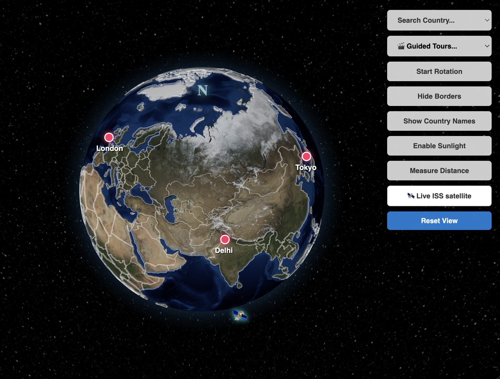
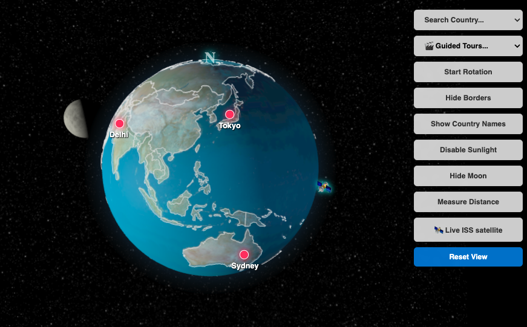

# 🌍 Interactive 3D React Globe

An interactive 3D web application built with React and `react-globe.gl`. This project renders a beautiful, fully interactive Earth with cinematic controls, real-time solar illumination, a precise distance measuring tool, live ISS tracking, cinematic guided tours and an instant country encyclopedia.

<div style="display: flex; margin-bottom: 10px;">
   
</div>

<div style="display: flex; gap: 10px;">
  
  
</div>

## ✨ Features

- **Cinematic 3D Environment**: High-performance Three.js/WebGL globe with auto-rotation, atmospheric glow, and a beautiful starscape background.
- **Guided Cinematic Tours**: An interactive "story mode" that smoothly flies the camera to curated global landmarks (e.g., the 7 Wonders of the World). Features a sleek glassmorphic panel with descriptions, custom local imagery, and clickable Wikipedia links.
- **Live ISS Satellite Tracking**: Fetches real-time telemetry data to render a glowing 3D International Space Station that orbits the globe. Includes a "Find ISS" button to instantly snap the camera to the astronauts' current location.
- **Slide-Out Encyclopedia**: Click any country (or search via the dropdown) to instantly slide out a sleek, glassmorphic info panel. Displays the country's flag, capital, population, languages, and currencies with zero API latency.
- **Real-Time Solar Illumination**: Toggle sunlight to simulate the exact real-world day/night cycle based on current UTC time. Darkens the night side and adds a realistic sun reflection to the oceans.
- **Orbital 3D Moon**: A dynamic, tidally-locked 3D Moon built with native Three.js that smoothly orbits the Earth. Features accurate relative sizing, a 5.14° orbital inclination, and reacts to the solar illumination tool to display realistic lunar phases.
- **Country Search & Highlighting**: Dropdown menu to search for any country. Calculates the centroid of the country's geometry and automatically flies the camera to it.
- **Interactive Distance Measure Tool**: Toggle measure mode to click any two points on the Earth. Draws a glowing 3D flight arc, radar rings, and calculates the exact real-world distance in kilometers using the Haversine formula.
- **Custom Map Markers**: HTML-based glowing city markers (New York, London, Tokyo, Sydney, Delhi, Bangalore, Bangkok, Cairo).

## 🛠 Tech Stack

- **Framework**: [React](https://reactjs.org/) (via [Vite](https://vitejs.dev/))
- **3D Globe**: [react-globe.gl](https://globe.gl/react/) (built on Three.js)
- **Styling**: Plain CSS with glassmorphic UI principles
- **Data Sources**:
  - Borders: Open-source GeoJSON map data.
  - Country Info: Local fetching of the `mledoze/countries` open-source JSON encyclopedia (bypasses CORS and API rate limits).
  - Flags: [FlagCDN](https://flagcdn.com/)
  - ISS Telemetry: [wheretheiss.at](https://wheretheiss.at/) (Free API)

## 📂 Project Structure

The project has been refactored into a clean, modular structure:

```text
src/
├── assets/tours/   # Local images for the guided tours
├── data.js         # Static data configurations (custom city coordinates)
├── tours.js        # Guided cinematic tour data and image imports
├── utils.js        # Helper functions (Haversine distance math, centroid calculations)
├── MyGlobe.css     # UI and layout styling
├── MyGlobe.jsx     # Main React component and 3D globe logic
├── main.jsx        # App entry point
```

## 🚀 Getting Started

To run this project locally, follow these steps:

1. **Install Dependencies**:
   Open terminal in the project directory and run:
   ```bash
   npm install
   ```
   _(Ensure you have `react-globe.gl` installed: `npm install react-globe.gl`)_
2. **Start the Development Server**:
   ```bash
   npm run dev
   ```
3. **Open in Browser**:
   Navigate to `http://localhost:5173` (or the port Vite provides) to interact with the globe!

---

_Built with React and Three.js_


